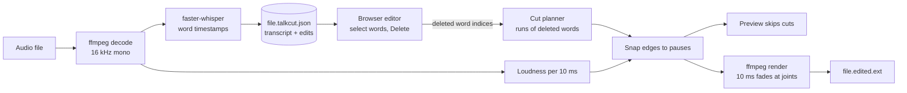

# talkcut

Edit spoken audio by editing its transcript. Transcription runs locally with Whisper; deleting a
word in the text deletes that stretch of audio. Nothing is uploaded, and the source file is never
modified.

> **Status:** milestone 1 of 4 (core loop) working end to end on a synthetic test clip. Audio
> only. Not yet tested on real podcast recordings or files longer than a few minutes; see
> [PLAN.md](PLAN.md).

## How it works



Every cut decision is made in one place (`talkcut/edit.py`). The page only sends which words are
deleted, so the preview and the export can't disagree. Design rules and the snapping algorithm:
[docs/01-architecture.md](docs/01-architecture.md).

## Run it

Requires Python 3.10–3.13, [uv](https://docs.astral.sh/uv/) and ffmpeg 7 or newer
(`brew install ffmpeg`).

```bash
uv sync
uv run talkcut episode.mp3                                   # opens the editor in your browser
uv run talkcut episode.mp3 --remove-fillers -o clean.mp3     # no editor: cut um/uh/hmm and export
uv run talkcut episode.mp3 --model small                     # slower, more accurate transcript
uv run pytest                                                # 12 tests: cut planning, snapping, render
```

The first run downloads the Whisper model (`base` is about 140 MB) from Hugging Face. After that,
everything works offline. The transcript and your edits are saved next to the file as
`episode.mp3.talkcut.json`; delete it to transcribe again.

| In the editor | |
| --- | --- |
| Click a word | Jump there |
| Select words, <kbd>Delete</kbd> | Cut them (or restore them, if they were all cut) |
| <kbd>Space</kbd> | Play / pause |
| <kbd>⌘Z</kbd> / <kbd>Ctrl+Z</kbd> | Undo |
| Delete fillers | Cut every um, uh, hmm, … |

## What has been measured (2026-11-09, Apple M4, 16 GB)

On one 12.2 s clip generated with macOS `say`, containing five filler words:

| Check | Result |
| --- | --- |
| Transcription, `base` model, int8 on CPU | 1.9 s wall time including model load (model already downloaded) |
| Fillers kept in the transcript | 5 of 5, with the verbatim prompt |
| Filler removal | 12.2 s → 9.0 s; re-transcribing the output finds no fillers and no damaged words |
| Whisper word-timestamp error | up to ~220 ms (start of "open": 3.84 s by timestamp, ~3.62 s by loudness) |

**The timestamp error is the finding that shaped the design.** Cutting exactly at Whisper's
timestamps clipped the start of "open" and the final "s" of "tools", so the output re-transcribed
as "VinSource tool". Cut edges are now snapped to real pauses in the audio. A second bug showed the
limit of that: with only 50 ms between "the first" and "one", snapping walked back into the gap
between "the" and "first" and quietly un-deleted "first". Snapping is now bounded so it can never
bring back more than 0.1 s of a deleted word. Both cases are unit tests.

A synthetic voice says its fillers clearly; real speech won't. These numbers show the loop works.
They say nothing yet about real recordings, which is M2 and M3.

## Limitations

- **Tested only on synthetic speech.** Filler recall, timestamp error and snapping on real
  recordings are unmeasured.
- **Whisper drops fillers.** The verbatim prompt helps on the test clip; how much on real speech
  is unknown. Filler removal can only cut what the transcript contains.
- **Pause detection is relative to the loudest parts of the file.** Noisy rooms will need a
  noise-floor estimate (M3).
- **Background tabs preview less precisely.** Browsers pause the per-frame loop in hidden tabs, so
  skipping falls back to `timeupdate` (about 4 times a second) and up to ~250 ms of cut audio can
  leak into the preview. Export is unaffected.
- **Audio only.** Video is M4.
- **Long files are untested.** The render builds one ffmpeg branch per kept segment; thousands of
  cuts may be slow.

## Docs

The plan and design record:

| # | Doc | What it settles |
| --- | --- | --- |
| 00 | [Charter](docs/00-charter.md) | Question, scope and non-goals, success criteria |
| 01 | [Architecture](docs/01-architecture.md) | Data flow, design rules, cut planning and snapping |

Brief: [SPEC.md](SPEC.md) · Plan and progress: [PLAN.md](PLAN.md)

MIT licence.
