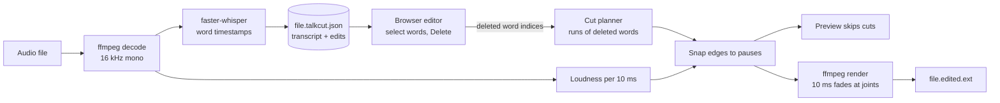

# talkcut

Edit spoken audio by editing its transcript. Transcription runs locally with Whisper; deleting a
word in the text deletes that stretch of audio. Nothing is uploaded, and the source file is never
modified.

> **Status:** milestone 1 of 4 (core loop) done, and checked on one real 59-minute podcast. Audio
> only. Filler detection and cut quality are measured below but not yet good enough to trust
> blindly; see [PLAN.md](PLAN.md).

## How it works



Every cut decision is made in one place (`talkcut/edit.py`). The page only sends which words are
deleted, so the preview and the export can't disagree. Design rules and the snapping algorithm:
[docs/01-architecture.md](docs/01-architecture.md).

## Run it

Requires Python 3.10–3.13, [uv](https://docs.astral.sh/uv/) and ffmpeg 7 or newer
(`brew install ffmpeg`).

```bash
uv sync
uv run talkcut episode.mp3                                   # opens the editor in your browser
uv run talkcut episode.mp3 --remove-fillers -o clean.mp3     # no editor: cut um/uh/hmm and export
uv run talkcut episode.mp3 --model small                     # slower, more accurate transcript
uv run pytest                                                # 13 tests: cut planning, snapping, render
uv run python bench/real_clip.py episode.mp3 --start 600     # filler count and cut damage on a real clip
uv run python bench/stability.py episode.mp3 --start 600     # which fillers survive inaudible changes
```

The first run downloads the Whisper model (`base` is about 140 MB) from Hugging Face. After that,
everything works offline. The transcript and your edits are saved next to the file as
`episode.mp3.talkcut.json`; delete it to transcribe again.

| In the editor | |
| --- | --- |
| Click a word | Jump there |
| Select words, <kbd>Delete</kbd> | Cut them (or restore them, if they were all cut) |
| <kbd>Space</kbd> | Play / pause |
| <kbd>⌘Z</kbd> / <kbd>Ctrl+Z</kbd> | Undo |
| Delete fillers | Cut every um, uh, hmm, … |

## What has been measured (2026-11-09, Apple M4, 16 GB)

### A real recording

NASA's *Houston We Have a Podcast*, episode 440 ("To the Moon and Back Again with Reid and
Christina"), 59 min, two astronauts and a host talking unscripted. US government work; not
redistributed here (`samples/` is gitignored).

| Check | Result |
| --- | --- |
| Transcription, whole episode, `base`, int8 on CPU | **180 s for 59 min** (about 20× real time), 2.5 GB peak memory, 10,685 words |
| Fillers found, whole episode, initial prompt only | 1 |
| Fillers found, whole episode, hotwords | **94** (transcription 153 s, 3.1 GB peak) |
| Fillers found, 5-min excerpt (10:00–15:00) | 0 plain, 3 with the prompt, **17 with hotwords** (`small` model: 13, 3× slower) |
| Fillers with sound under them | 16 of 17 |
| Same audio, transcribed 3 times | identical: 17 fillers at the same timestamps each time |
| Six versions you couldn't tell apart (10 ms edge fades, -80 dB noise, start 0.5–2 s later) | 14–17 fillers each, at **21 distinct spots; only 8 found by every version** (`bench/stability.py`) |

Cut damage, measured by `bench/real_clip.py`. For each of the 17 filler cuts, the kept word on
either side should still be in the export at the predicted time. Whisper transcribes each export
again and looks them up. Transcribing the whole export and diffing it doesn't work: removing audio
shifts Whisper's 30 s windows, and words far from any cut come out differently ("Matt Dominick"
becomes "Mathematica").

| Export | Neighbour words that survive | Fillers heard afterwards |
| --- | --- | --- |
| No cuts (baseline) | 34 of 34 | 23 |
| **Fillers removed, snapped** | **31 of 34** | 4 |
| Fillers removed, not snapped | 28 of 34 | 2 |

**What this says.** Speed is solved: an hour transcribes in three minutes on a laptop. Snapping
halves the damage on real speech, but 3 of 34 neighbouring words still get hurt, and snapping
leaves a few filler fragments because it may keep up to 0.1 s of a deleted word. The weakest link
is detection. The prompt that worked on synthetic speech found almost nothing on the real
episode, because it only conditions Whisper's first 30 s window; hotwords apply to every
window. Detection is deterministic but fragile: Whisper decodes in 30 s windows and each one
starts where the last ended, so a change no one could hear moves every boundary after it, and
borderline fillers drop in or out. One transcription catches about two thirds of the spots that
some version finds, and most of the spots it misses have sound under them. Transcribing twice
and taking the union would catch more, at twice the time, but whether those extra spots are
real fillers needs a hand-labelled clip first. The episode is professionally produced and may
have had fillers edited out already; nobody has listened and labelled it yet.

### Editing the whole episode

10,755 words in the browser editor, all 94 fillers deleted (92 cuts after merging neighbours):

| Operation | Before | After |
| --- | --- | --- |
| Load and render the transcript | 32 ms fetch (474 KB), 76 ms render | (unchanged) |
| Delete fillers: save, re-plan, snap | 52 ms round trip | (unchanged) |
| Select 2,000 words | **4,178 ms** | **0.2 ms** |
| Export 57 min of mp3 | **71.9 s** | **16.8 s** (re-encoding with no cuts: 14.5 s) |

Selection asked the browser about every word on the page; it now reads the selection's two ends.
Export gave ffmpeg one filter branch per kept range on a single input, so every decoded frame
went to every branch; each range is now its own seeked input. That needs one open file per
range, so render raises the process limit (macOS shells default to 256, and ffmpeg failed at
input 253 without it).

### A synthetic clip

One 12.2 s clip generated with macOS `say`, containing five filler words:

| Check | Result |
| --- | --- |
| Transcription, `base` model, int8 on CPU | 1.9 s wall time including model load (model already downloaded) |
| Fillers kept in the transcript | 5 of 5, with the initial prompt (since replaced by hotwords) |
| Filler removal | 12.2 s → 9.0 s; re-transcribing the output finds no fillers and no damaged words |
| Whisper word-timestamp error | up to ~220 ms (start of "open": 3.84 s by timestamp, ~3.62 s by loudness) |

**The timestamp error is the finding that shaped the design.** Cutting exactly at Whisper's
timestamps clipped the start of "open" and the final "s" of "tools", so the output re-transcribed
as "VinSource tool". Cut edges are now snapped to real pauses in the audio. A second bug showed the
limit of that: with only 50 ms between "the first" and "one", snapping walked back into the gap
between "the" and "first" and quietly un-deleted "first". Snapping is now bounded so it can never
bring back more than 0.1 s of a deleted word. Both cases are unit tests.

## Limitations

- **One real recording so far**, professionally produced, three speakers. No hand-labelled ground
  truth, so filler *recall* is unknown; only counts and "has sound under it" are measured.
- **Filler detection is fragile.** The same file always gives the same transcript (and it is
  saved, so the editor never changes under you), but audio that differs inaudibly can give a
  different set of fillers. Filler removal can only cut what the transcript contains.
- **Cuts still hurt about 1 in 11 neighbouring words** on the real excerpt (3 of 34), and can
  leave short filler fragments.
- **Pause detection is relative to the loudest parts of the file.** Noisy rooms will need a
  noise-floor estimate (M3).
- **Background tabs preview less precisely.** Browsers pause the per-frame loop in hidden tabs, so
  skipping falls back to `timeupdate` (about 4 times a second) and up to ~250 ms of cut audio can
  leak into the preview. Export is unaffected.
- **Audio only.** Video is M4.
- **Tested at one hour, not beyond.** A two-hour episode, or thousands of cuts, hasn't been tried.
  Transcription memory peaked at 3.1 GB for one hour.

## Contributing

The most useful help right now is running talkcut on your own recordings and filing a
**Recording report**, and the issues labelled
[`measurement`](https://github.com/Dhruv-Sharma29/talkcut/labels/measurement) and
[`good first issue`](https://github.com/Dhruv-Sharma29/talkcut/labels/good%20first%20issue).
Setup, the rules a pull request must keep, and how numbers get into this README:
[CONTRIBUTING.md](CONTRIBUTING.md). Coding agents: [AGENTS.md](AGENTS.md).

## Docs

The plan and design record:

| # | Doc | What it settles |
| --- | --- | --- |
| 00 | [Charter](docs/00-charter.md) | Question, scope and non-goals, success criteria |
| 01 | [Architecture](docs/01-architecture.md) | Data flow, design rules, cut planning and snapping |

Brief: [SPEC.md](SPEC.md) · Plan and progress: [PLAN.md](PLAN.md)

MIT licence.
